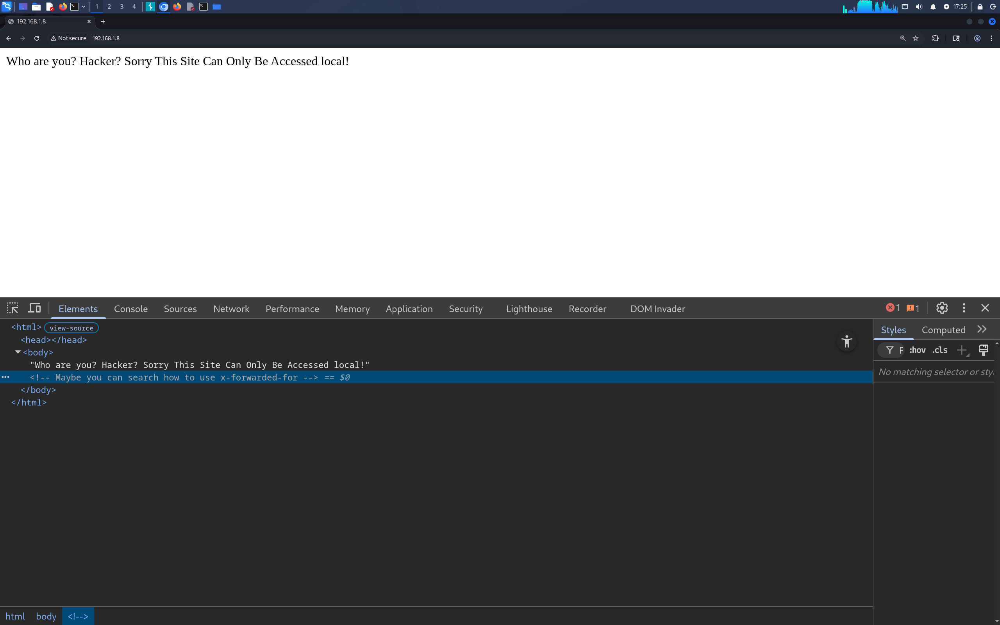
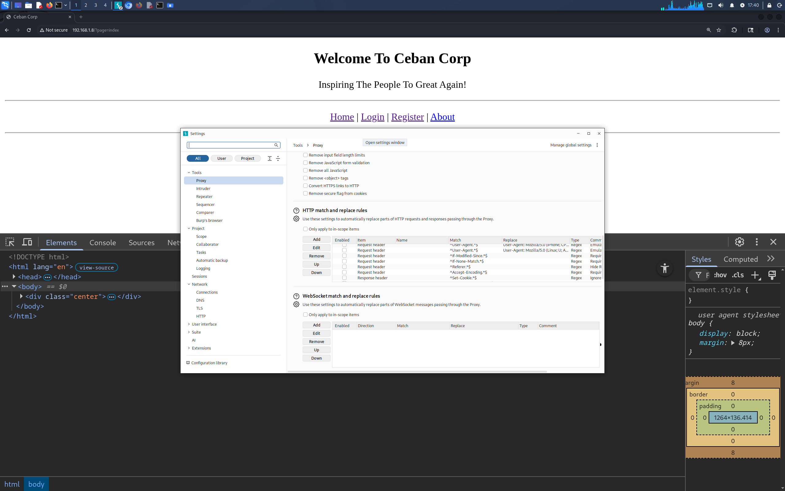
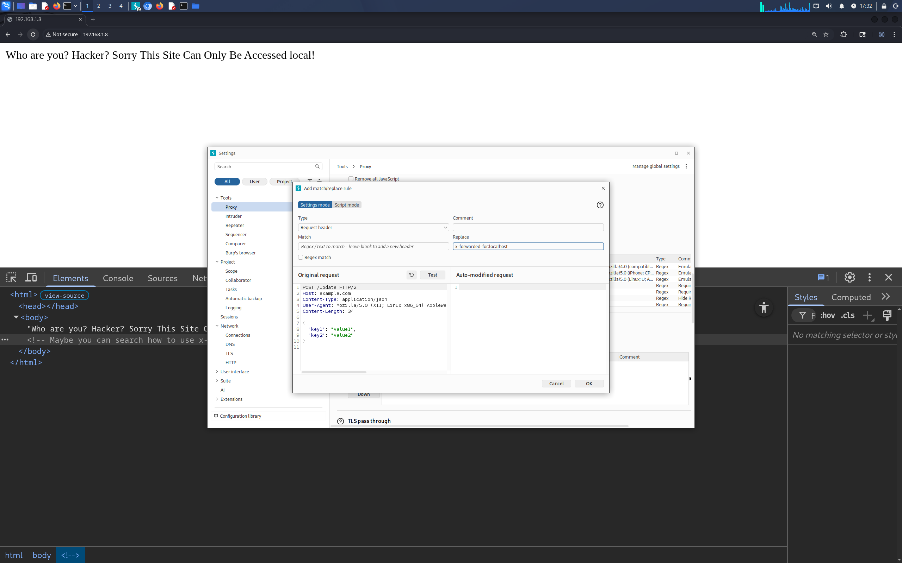
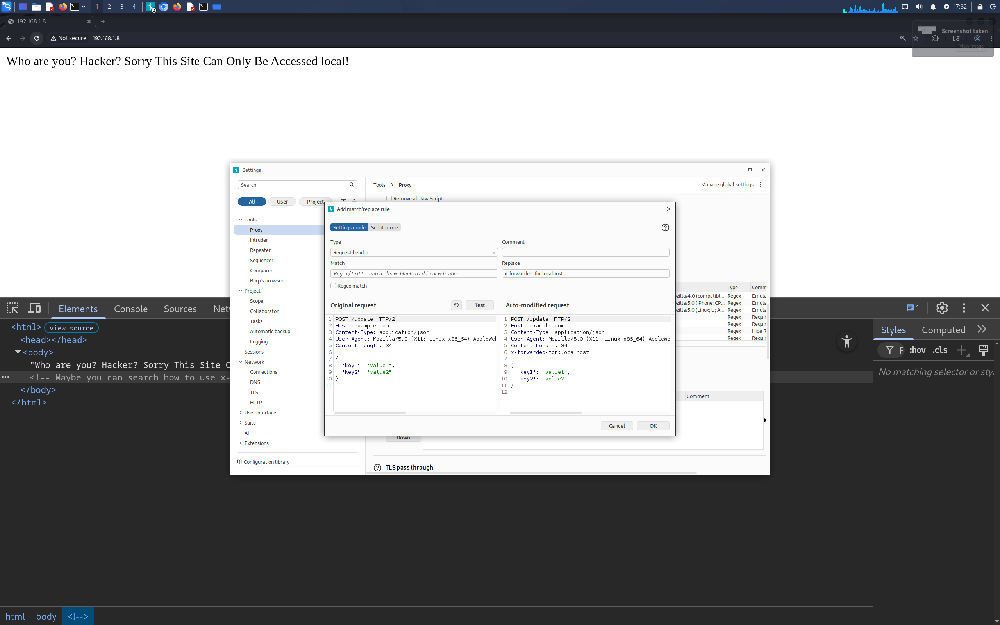

## john-the-ripper

如果不清楚破解的format 有哪几种格式。使用以下命令
```
sudo john --list=formats
```


破解 MD5
纯MD5
```
# 字典爆破（必须显式指定 raw-md5 格式）
john --format=raw-md5 --wordlist=/usr/share/wordlists/rockyou.txt md5.txt

# 看结果
john --show md5.txt
```

Unix MD5
```
# 合并 passwd 和 shadow 
unshadow passwd shadow > hashes 
john --format=md5crypt hashes --wordlist=/usr/share/wordlists/rockyou.txt
```


破解 id_rsa 的 passphrase

```
ssh2john my_ssh_key > ssh_hash.txt
john --wordlist=wordlist.txt ssh_hash.txt
```

## tar

```
tar zxvf xxx.tar.gz
tar jxvf xxx.tar.bz2 
```

## hashcat


## Burp Suite


代理添加请求头操作。在某次靶场的实际中，网站需要 http 的请求头一定要包含这个字段

```text
x-forwarded-for:localhost
```

为了避免每次发给代理时，我们都手动添加请求头这种情况，BurpSuite 支持自动添加请求头。



点击 Http 请求头替换规则，就可。






然后配置点击 test。



